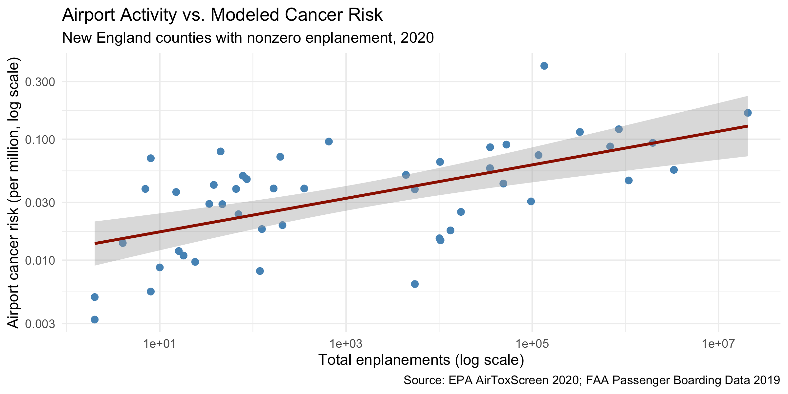

# Aviation's Public Health Footprint in New England

How much does airport activity contribute to cancer risk in New England, and how does that compare with what research on major airports suggests? Joining EPA and FAA data at the county level, I find a statistically significant but small relationship.

**[Read the paper (PDF)](paper.pdf)** · Political Economy of Public Health final paper, Colby College, May 2026

## Key findings

- A 10% increase in county enplanements is associated with about a **1.4% increase** in modeled aviation-attributable cancer risk (p < 0.001), and the estimate holds when controlling for number of airports and population.
- Aviation's share of total modeled cancer risk rarely exceeds 0.5% and passes 1% in only one county (Nantucket). On-road vehicles dominate in every state.
- County averaging likely understates exposure for people living closest to runways, which is the main limitation of the available data.

## Methods

- **Data:** EPA AirToxScreen 2020 (modeled cancer risk by source), FAA 2019 passenger boarding data, FAA airport runway data. 48 New England counties.
- **Models:** log-log OLS of airport-attributable cancer risk on enplanements, with controls; lead emissions comparison; regression diagnostics.
- **Tools:** R (`tidyverse`, `modelsummary`, `broom`), Quarto.

## Files

- `paper.pdf`: full paper with literature review, figures, and policy discussion
- `analysis.R`: data joins, models, and figures
